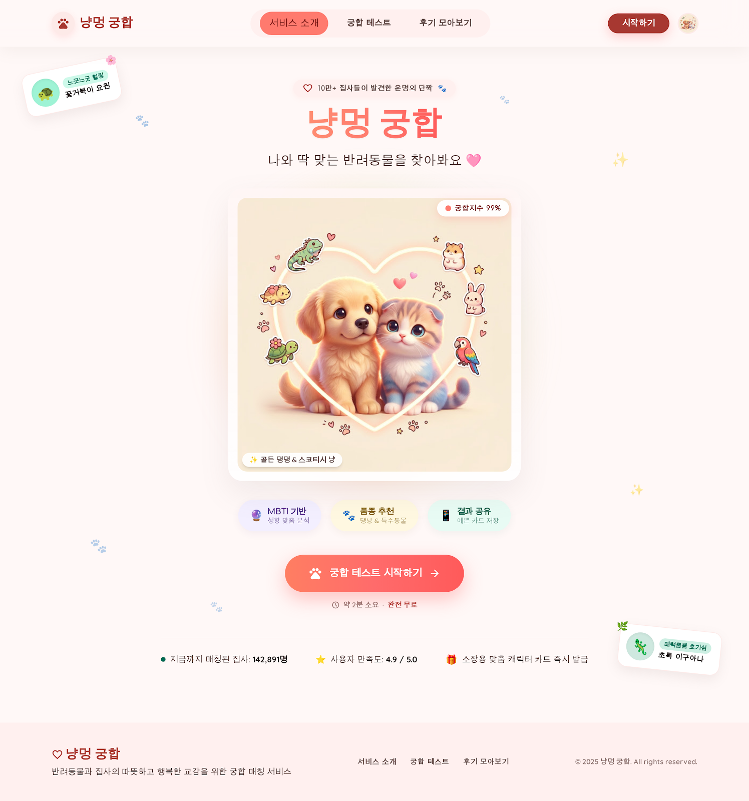
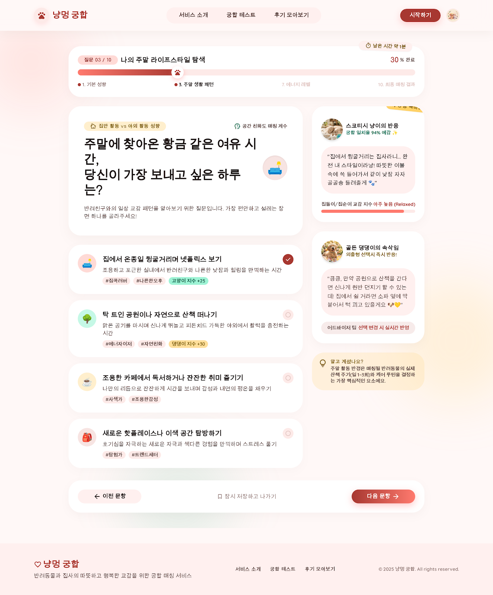
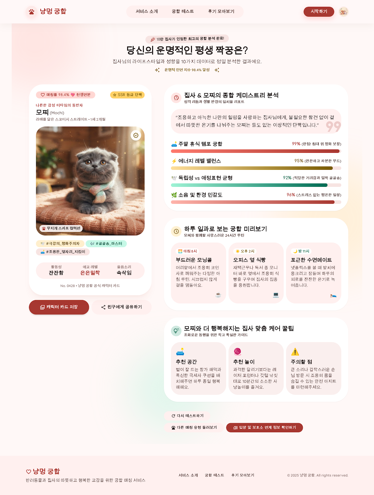
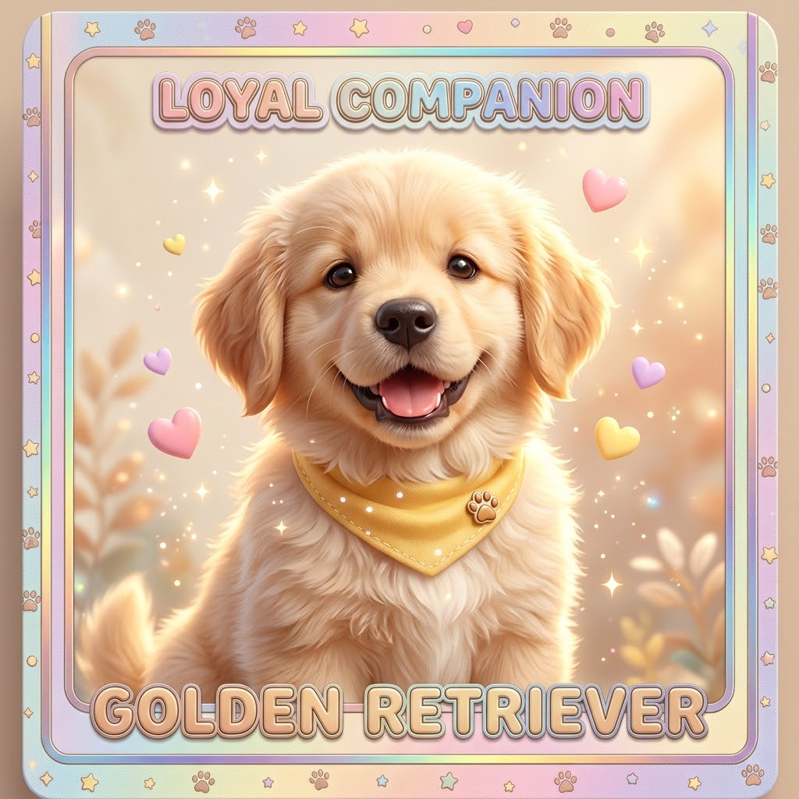
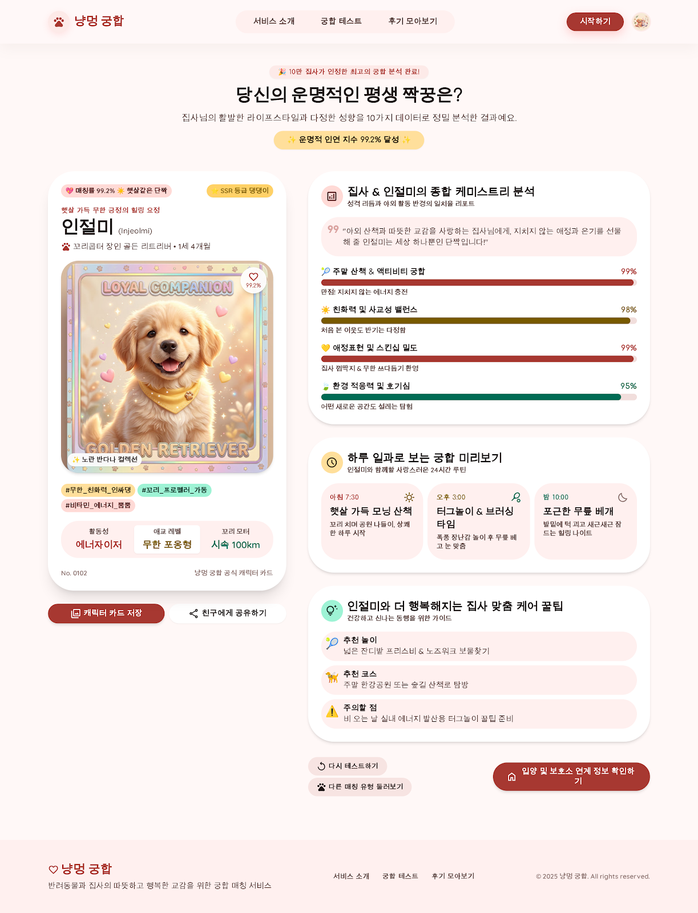
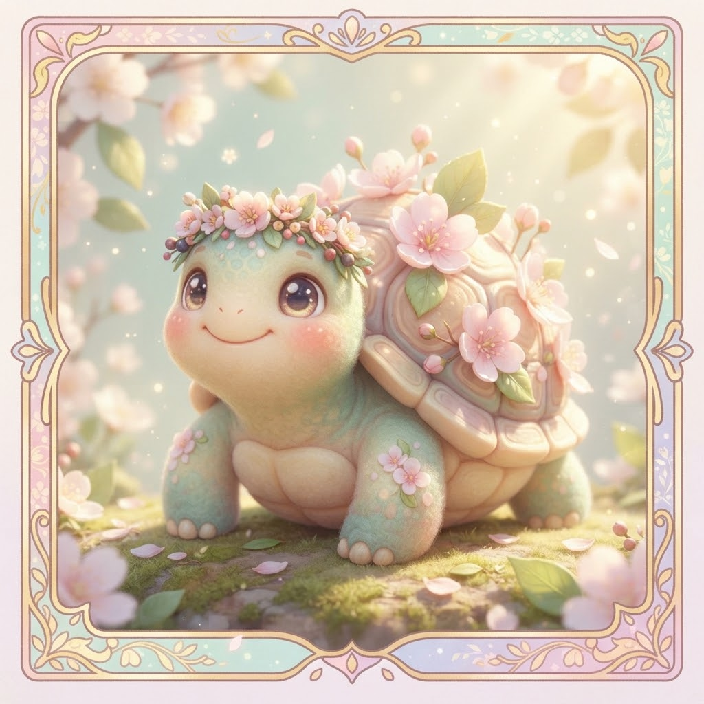
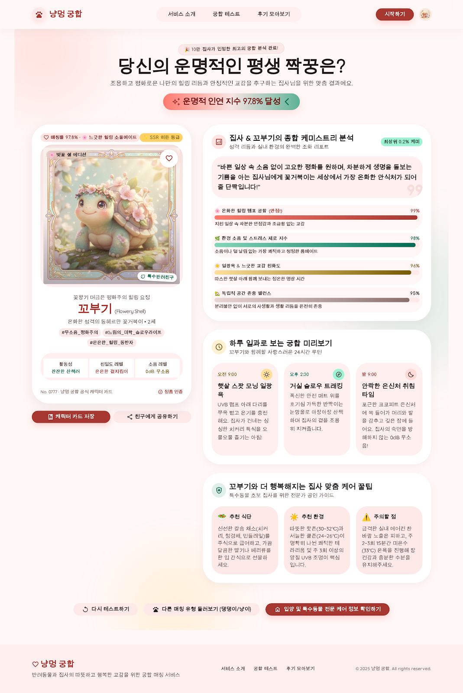
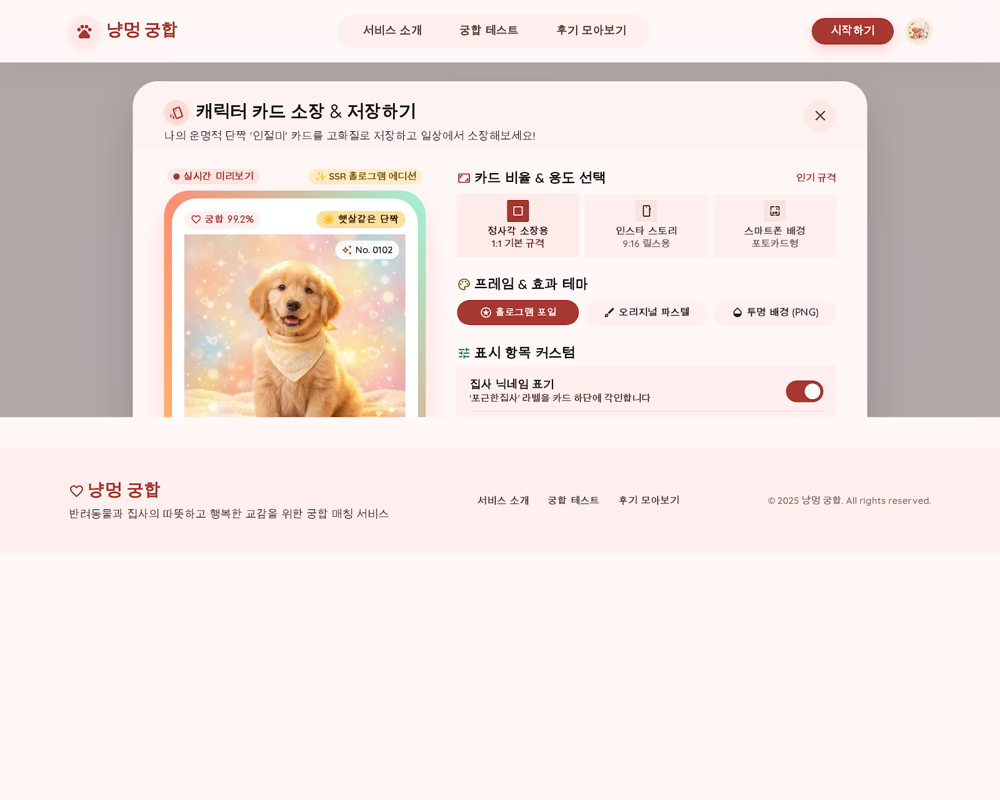
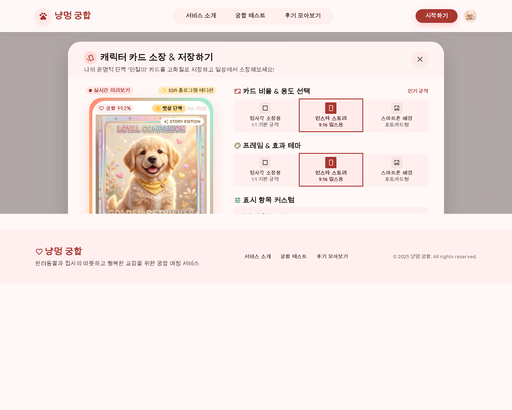

# 냥멍 궁합 — 디자인 스펙

## Stitch 프로젝트
- **프로젝트명:** Pet Compatibility Landing Page
- **프로젝트 ID:** `1099382073413074369`
- **디바이스 타입:** Desktop (2560px 기준)
- **화면 수:** 9개

---

## 디자인 테마

| 항목 | 값 |
|------|-----|
| 헤드라인 폰트 | Comfortaa |
| 바디 폰트 | Quicksand |
| 라벨 폰트 | Comfortaa |
| 컬러 모드 | Light |
| 라운드니스 | Full (완전 둥근 모서리) |
| 포인트 컬러 | `#ff7a6e` (코랄 피치) |

### 컬러 팔레트

| 역할 | 색상 코드 | 설명 |
|------|-----------|------|
| Background | `#fff8f7` | 따뜻한 오프화이트 |
| Surface | `#fff8f7` | 카드 배경 |
| Primary | `#ff7a6e` | 메인 포인트 (코랄) |
| Tertiary | `#006b54` | 보조 포인트 (딥 티얼) |
| On Background | `#231918` | 본문 텍스트 |
| Error Container | `#ffdad6` | 오류/강조 영역 |

---

## 화면 목록

### 1. 랜딩 페이지
**파일:** `design/01_landing.png`  
**크기:** 2560 × 2738px  
**화면 ID:** `6f776fb1d29241ad93cebe1f9ece4dca`



- 서비스 소개 히어로 섹션
- CTA 버튼으로 테스트 시작 유도
- 귀여운 반려동물 일러스트 포함

---

### 2. 테스트 문항 진행
**파일:** `design/02_input_form.png`  
**크기:** 2560 × 3092px  
**화면 ID:** `26dad6c8aad7444b8634e51043da4065`



- 사용자 정보 및 성향 질문 폼
- 단계별 진행 UI (스텝 인디케이터)
- MBTI 또는 성향 선택 옵션

---

### 3. 매칭 결과 리포트
**파일:** `design/03_match_result.png`  
**크기:** 2560 × 3380px  
**화면 ID:** `a397b9f24a194c9c9807a70ed033b38a`



- 궁합 점수 표시 (도넛 차트 또는 퍼센트)
- 반려동물 유형 매칭 결과
- 상세 분석 텍스트

---

### 4. 골든 리트리버 일러스트
**파일:** `design/04_golden_retriever_illust.png`  
**크기:** 1024 × 1024px  
**화면 ID:** `0f02dd9bceb1496795c8a7831183a713`



- 3D 파스텔 스타일 골든 리트리버 캐릭터 카드
- 노란 반다나 컬러, 발바닥 브로치 디테일
- 따뜻한 골든/크림 배경, 수집형 트레이딩 카드 감성

---

### 5. 매칭 결과 리포트 — 골든 댕댕이 버전
**파일:** `design/05_match_report_golden.png`  
**크기:** 2560 × 3348px  
**화면 ID:** `02972016781b47e589526a556245c895`



- 골든 리트리버 매칭 결과 상세 리포트
- 성격 분석, 함께하는 생활 팁 포함
- 캐릭터 카드 + 상세 텍스트 레이아웃

---

### 6. 거북이 일러스트
**파일:** `design/06_tortoise_illust.png`  
**크기:** 1024 × 1024px  
**화면 ID:** `1040bf8334214bdb9072486ddc9b9ccc`



- 3D 파스텔 스타일 거북이 캐릭터 카드
- 벚꽃 화관 장식, 민트/크림 배경
- 힐링 감성, 수집형 트레이딩 카드 스타일

---

### 7. 매칭 결과 리포트 — 꽃거북이 버전
**파일:** `design/07_match_report_tortoise.png`  
**크기:** 2560 × 3830px  
**화면 ID:** `1818aa52bff4455395589cc764a23ba6`



- 거북이 매칭 결과 상세 리포트
- 가장 긴 화면 (3830px) — 콘텐츠 풍부
- 성격 분석, 함께하는 생활 팁 포함

---

### 8. 카드 저장 모달
**파일:** `design/08_save_card_modal.png`  
**크기:** 2560 × 2048px  
**화면 ID:** `c4e74594cc114cd696986a02b5db0efa`



- 결과 카드 저장/공유 모달
- 이미지 다운로드 또는 SNS 공유 옵션
- 오버레이 모달 디자인

---

### 9. 카드 저장 모달 — 인스타그램 스토리 (9:16)
**파일:** `design/09_save_card_instagram.png`  
**크기:** 2560 × 2048px  
**화면 ID:** `bcd60908468846df95706bb80361d52d`



- 인스타그램 스토리 포맷 (9:16 비율) 내보내기
- 세로형 카드 레이아웃
- SNS 최적화 디자인

---

## 주요 UX 플로우

```
랜딩 페이지 (01)
    ↓ [테스트 시작]
테스트 문항 진행 (02)
    ↓ [완료]
매칭 결과 리포트 (03)
    ↓ [반려동물 유형에 따라 분기]
    ├── 골든 댕댕이 결과 (05) ← 골든 리트리버 일러스트 (04)
    └── 꽃거북이 결과 (07) ← 거북이 일러스트 (06)
        ↓ [저장/공유]
카드 저장 모달 (08)
    ├── 이미지 저장
    └── 인스타 스토리 저장 (09)
```

---

## 개발 참고사항

- **폰트 임포트:** Google Fonts — Comfortaa, Quicksand
- **라운드니스:** `border-radius: 9999px` (pill 스타일 버튼/배지)
- **반응형:** Stitch 원본은 2560px 데스크톱 기준. 실제 구현 시 모바일 우선 (375px) 으로 재설계 권장
- **일러스트:** 화면 4, 6은 AI 생성 이미지 — 실제 구현 시 동일 스타일로 재생성 또는 대체 필요
- **HTML 코드:** 각 화면의 Stitch 생성 HTML은 Stitch API `htmlCode.downloadUrl`로 접근 가능
